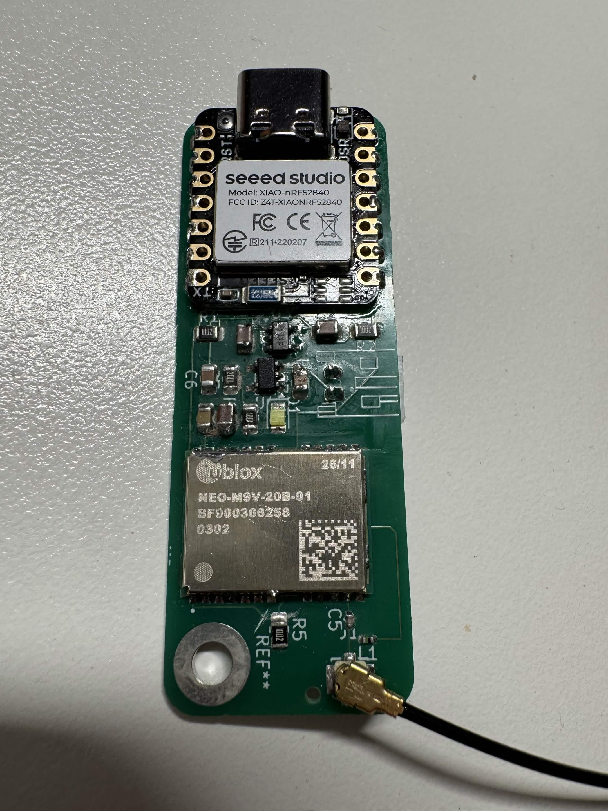

# Aevia

Aevia is a DIY, battery powered lap timer and track data logger. The current hardware is the V2 Mini, a compact board that combines multi-band GNSS, a 6-axis IMU, local storage, a display interface, physical controls, and wireless connectivity.

The goal is to build something in the same general space as a Garmin Catalyst, but at a lower cost and with more control over the hardware, raw data, and software. Recorded data should also remain useful outside the device, with export to proper desktop analysis tools.

## V2 Mini hardware

The V2 Mini is built around:

- `ESP32-S31-WROOM-3-N16R16V` as the main processor and radio
- `UM980` multi-band, multi-constellation GNSS receiver
- `SCH16T-K01-1` 6-axis accelerometer and gyroscope
- microSD storage over 4-bit SDIO
- a 24-pin SPI display interface for the Adafruit 4520
- four UI buttons and four RGB status LEDs
- native USB data and USB-C power
- a 1-cell battery charger, fuel gauge, and push-button power control

See [v2_mini_design.md](./v2_mini_design.md) for the block diagrams, power tree, fitted parts, and current one-off build estimate.

## Firmware and app

The [Aevia application](./app/README.md) now has a Flutter interface for USB
recording, session import/export, local track replay, lap/sector comparison,
custom track gates, configurable drag tests and a PPK workspace. Its receiver-only measurement
path reuses Traj and labels missing or unqualified evidence explicitly.

The application firmware now acquires the UM980 and SCH16T, reports battery and
peripheral health, supports USB telemetry and exFAT SD recording, and exposes
recording downloads. See the [application protocol](./firmware/docs/application-protocol.md)
for controls, recording formats and current hardware limitations. The recovery
loader remains the upload path. These builds still require verification on the
fitted board for outdoor accuracy and calibrated timing. The on-device Traj estimator is explicitly a development profile;
mounting and sensor timing calibration remain unqualified.

The [base firmware](./firmware/README.md) now provides structured hardware
bring-up and a button-free J6 USB flash runner. From `firmware/`, run
`cargo run --release --locked` to build, flash and verify the restart.

The current hardware configuration enables battery, GNSS and IMU acquisition.
Display support is present but disabled until a panel is attached; extra buttons
are disabled and the app provides recording controls. Four LEDs indicate GNSS,
IMU, storage/recording and power state. See the
[20 Hz verification record](./data/aevia-implementation-status.md) for checks and
outstanding hardware validation.

The higher-rate profile requests 50 Hz native binary standalone GNSS (`SPPNAVB`)
in UM980 signal group 8
and records every native SCH16T DEC5 interval (approximately 727 Hz on this
board). SD recordings also retain 5 Hz raw GNSS observations and ephemerides
for RINEX export and PPK with a matching base recording. See the
[higher-rate validation and PPK workflow](./data/highrate-ppk-validation.md)
for measured rates, evidence retention and qualification limits.

## Roadmap

### High priority

- [ ] Delta T lap timing with colour coding
- [ ] Raw-data analysis that can support lap times reported to 0.001 seconds and show the limits of the hardware
- [ ] Export to Harry's LapTimer or another tool that accepts the recorded data

### Medium priority

- [ ] G-G diagram, with filtering suitable for noisy IMU output
- [ ] Automatic track detection
  - [ ] Track learning mode
  - [x] Manual start and finish line setup
- [ ] Smart battery management
- [x] Theoretical best lap time
- [ ] Automatic recording based on acceleration
- [x] Sector splits for tracks that support them

### Low priority

- [ ] Configurable LED bar
- [ ] Customisable gauges
- [ ] Colour themes

### Stretch ideas

- [ ] CAN bus or OBD data logging for brake, throttle, and other vehicle data
- [ ] Bluetooth support through the ESP32
  - [ ] RTK corrections, with a target of roughly 50 Hz and centimetre-level positioning
  - [ ] Firmware updates over Bluetooth
- [ ] Action camera synchronisation

## Why the UM980

Of the modules considered, the UM980 is the best fit I found for raw GNSS quality at this price. It can output at 20 Hz with its broader constellation selection; the current 50 Hz standalone profile uses signal group 8 and gives up GLONASS/NavIC. Constellation selection matters in a car because an antenna inside the windscreen loses much of its view behind the metal roof. Combining multiple constellations leaves more satellites available for each fix. A receiver advertised as "multi-GNSS" does not necessarily support its maximum update rate while using every constellation at once.

It also supports multiple frequency bands. A single-band receiver has a harder time separating a direct signal from one reflected by the car or nearby barriers. Comparing L1 with L2 or L5 gives the receiver more information for rejecting poor measurements.

The planned BT-T076 is a wide multi-band active helical antenna, although its sheet does not explicitly document every UM980 signal. Helical designs generally tolerate tilt and an uncertain ground plane better than conventional patches, but the BT-T076 datasheet does not publish the angular, per-band patterns needed to rank it against a particular patch. A correctly integrated patch that covers every required band may provide cleaner measurements in a fixed installation; many common patches are only L1 or depend on a specific ground plane. See [the GNSS antenna decision note](./gnss_antenna_design.md) for the mounting scenarios, electrical constraints, expected data effects, and A/B test plan.

The expected gain over a decent off-the-shelf logger is not enormous, and software quality will matter just as much as the receiver. For absolute lap-time proof, a track transponder still wins.

### Receivers considered

These figures are working notes from the module research and should be checked again before buying parts.

| Receiver | Notes |
|---|---|
| Unicore `UM980` | L1, L2/L5, and L6; multi-constellation; full RTK; 20 Hz with full multi-GNSS; 50 Hz standalone with SG8 and compatible firmware; roughly A$130 |
| u-blox `NEO-M9N` | L1-only; multi-constellation; 25 Hz with one constellation or 10 Hz with several; roughly A$20 |
| u-blox `NEO-M10S` | L1-only; multi-constellation; 25 Hz with one constellation or 10 Hz with several; roughly A$20 |
| u-blox `ZED-F9P` | L1 and L2; multi-constellation; full RTK; about 8 Hz with everything enabled or 20 Hz with a reduced configuration; roughly A$130 |
| Quectel `LC29H-DA/EA` | L1 and L5; multi-constellation; RTK on the EA variant; 10 Hz maximum |
| Septentrio `mosaic-X5` | All bands and constellations; the best raw quality in this comparison; capable of 100 Hz; more than A$1,000 |
| SkyTraq `PX1122R` | L1 and L2; multi-constellation RTK; apparently up to 20 Hz, although documentation and pricing were difficult to find |

The Dragy Pro was the only off-the-shelf product for which I could identify the receiver module. It uses a u-blox NEO-M10S and is listed in the research as 10 Hz with multiple constellations or 20 Hz with one. I have not found a module that clearly delivers 25 Hz, multi-GNSS, and 10 cm accuracy at the same time, so similar product claims are unlikely to be real.

The longer comparison is in [data/gps_module_research.md](./data/gps_module_research.md).
And raw GNSS modules specs are in [data/GNSS_research.xlsx](./data/GNSS_research.xlsx).

## Repository map

- [V2 Mini design notes](./v2_mini_design.md)
- [GNSS helix-versus-patch and dashboard placement analysis](./gnss_antenna_design.md)
- [V2 Mini KiCad project](./hardware/v2_mini_pcb/v2_mini.kicad_pro)
- [V2 Mini root schematic](./hardware/v2_mini_pcb/v2_mini.kicad_sch)
- [V2 Mini PCB layout](./hardware/v2_mini_pcb/v2_mini.kicad_pcb)
- [V2 Mini production BOM](./hardware/v2_mini_pcb/production/digikey_bom.csv)
- [GNSS module research](./data/gps_module_research.md)
- [V1 PCB files](./hardware/v1_pcb/)
- [Earlier full-size V2 design notes](./v2_design.md)

## Building it

I do not recommend this as a first electronics build. Several parts need reflow equipment or a capable hot-air setup, and a one off board involves a fair amount of tooling and rework cost. The V2 Mini estimate is about $500AUD for the PCB, stencil, parts, GNSS receiver, antenna, and battery.

## V1 archive

